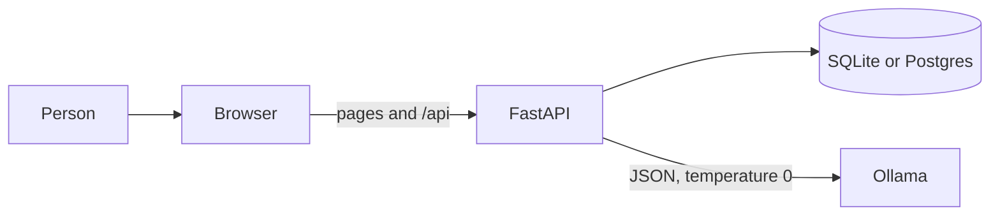
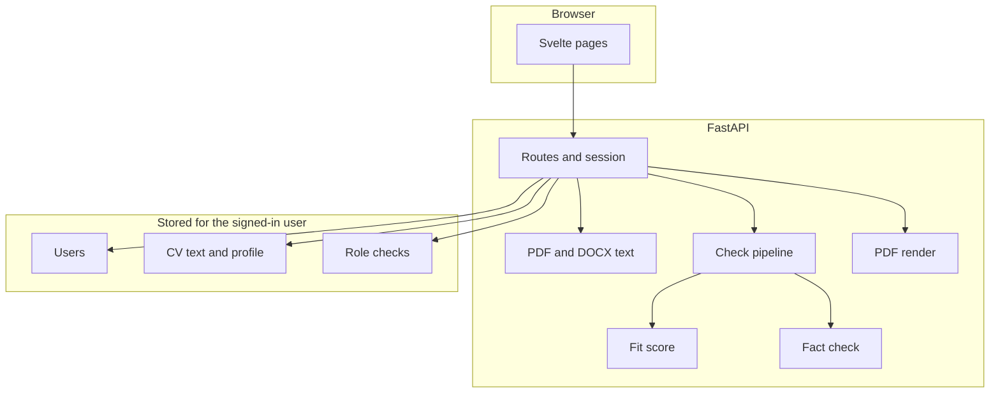
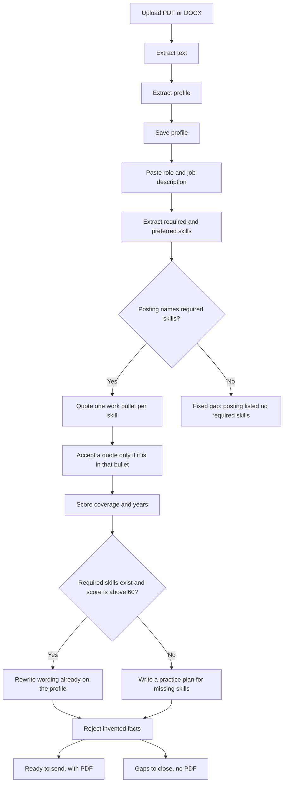
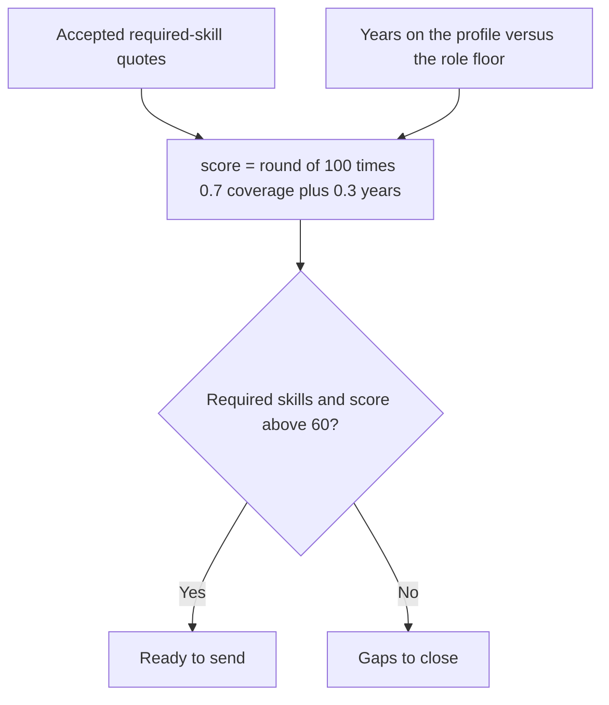

# Green Grass

Green Grass checks one CV against one job. A signed-in person uploads a text PDF or DOCX, pastes a role, and gets one of two honest results: a fact-checked CV they can download as a PDF, or a practice plan for required skills the work history does not show.

The model extracts structure and rewrites wording. It does not decide whether the CV is ready, and it does not invent employers, titles, dates, degrees, tools, or numbers. Suitability is scored in code.

## What you get

1. Upload a text PDF or DOCX. The original file is discarded. The server keeps the extracted text and a structured profile.
2. Paste a role title and job description.
3. The server pulls required and preferred skills from the posting, then scores the saved profile.
4. **Ready to send** when the score clears the bar: a rewritten CV, the fit report, and a PDF download.
5. **Gaps to close** when it does not: missing required skills first, then preferred skills, with a way to practice each one. There is no rewritten CV and no PDF.

A required skill counts when the screen quotes a real bullet from the work history and that quote is a contiguous excerpt of the bullet. A bullet can show a skill through work built on it, such as a Next.js app showing React. If no bullet shows it, the skill still counts when it appears in the CV's skills list, and the review says it came from the skills list.

## System

The browser talks to one FastAPI process. That process owns sessions, the database, CV parsing, the fit score, fact checks, and PDF rendering. Ollama is called only for extraction, screening quotes, wording, and practice plans.



Locally, SQLite lives at `data/greengrass.db`. On Render, the same app uses Postgres through `DATABASE_URL`. Tables are created on startup. There is no migration tool.

In development, Vite on port 5173 proxies `/api` and `/health` to FastAPI on port 8000. After `npm run build`, FastAPI serves `frontend/dist` itself, so one process is enough.



## Check pipeline

Upload builds a profile once. Each role check reuses that profile. A failed fact check is not saved.



When every required skill has an accepted quote and the score still fails, the plan is a single item: years of experience. The app does not ask the person to change dates.



Coverage is the share of required skills with an accepted quote. Years use the higher of the posting’s minimum and a seniority floor: junior 0, mid 3, senior 5, lead 8, staff 8, principal 10. Missing years count as 0. Preferred skills never block a result. Matched preferred skills can appear as “Also on the CV”.

## Local setup

You need Python 3.12, Node.js 22, and an [Ollama](https://ollama.com) API key. PDF download also needs the WeasyPrint system libraries: on macOS, `brew install pango`; on Debian or Ubuntu, the Cairo, Pango, and GDK-Pixbuf packages installed in the `Dockerfile`.

```bash
python3.12 -m venv .venv
source .venv/bin/activate
pip install -r requirements.txt
cp .env.example .env
```

Edit `.env` and set `OLLAMA_API_KEY`. Leave `COOKIE_SECURE=0` for local HTTP. The app reads `.env` from the repository root. A value already set in the shell wins over the file. `.env` is gitignored.

Build the frontend, then start the API. Open [http://127.0.0.1:8000](http://127.0.0.1:8000).

```bash
cd frontend && npm ci && npm run build && cd ..
uvicorn app.main:app --reload --port 8000
```

For frontend work, keep that API running and start Vite in another terminal. Open [http://127.0.0.1:5173](http://127.0.0.1:5173).

```bash
cd frontend && npm run dev
```

An empty `OLLAMA_API_KEY` makes upload and role checks return 503. Register and login still work. Passwords are at least 8 characters.

### Environment

| Variable | Local default | Purpose |
| --- | --- | --- |
| `DATABASE_URL` | `sqlite:///./data/greengrass.db` | SQLite locally, Postgres on Render |
| `SESSION_SECRET` | change this | Signs the session cookie |
| `OLLAMA_API_KEY` | empty | Server-side key for Ollama |
| `OLLAMA_MODEL` | `gemma4:31b` | Model name |
| `OLLAMA_HOST` | `https://ollama.com` | Ollama API host |
| `COOKIE_SECURE` | `0` | Set to `1` only behind HTTPS |

### Limits

Uploads are PDF or DOCX, at most 5 MB, with 40 to 40,000 characters of extracted text. Scanned PDFs are rejected. Job descriptions are at most 20,000 characters. Another person’s CV or check returns 404.

### Tests

```bash
python -m pytest
```

API tests use a scripted model and do not call Ollama.

## Pages

| Path | Page |
| --- | --- |
| `/` | Desk of saved CVs and checks |
| `/login`, `/register` | Session |
| `/cvs/new` | Upload |
| `/cvs/{id}` | Saved profile and earlier checks |
| `/apply?cv={id}` | Paste one role |
| `/applications/{id}` | Ready CV or gap plan |

Mutations send the `x-csrf-token` header from `GET /api/session`. `GET /api/applications/{id}/pdf` is available only when the check is ready to send.

## Layout

| Path | Role |
| --- | --- |
| `app/main.py` | HTTP, ownership, session, and the built SPA |
| `app/services/pipeline.py` | Profile, then a CV or a gap plan |
| `app/services/fit.py` | Quote check and score |
| `app/services/facts.py` | Blocks invented CV facts and bad gap plans |
| `app/services/llm.py` | Ollama client |
| `app/services/parser.py` | PDF and DOCX text |
| `app/services/pdf.py` | HTML and WeasyPrint |
| `frontend/src/pages/` | Svelte pages |
| `render.yaml` | Render web service and Postgres |
| `Dockerfile` | Node build, then Python 3.12 |

### Company logos

CV details, ready results, and shared profiles load employer logos separately from
CV content. `app/services/logos.py` looks up an exact name or alias in Wikidata,
requires a single match with an official website and a current logo claim, and
resolves that image through Wikimedia Commons. Only the employer name is sent;
CV text and contact details are not sent. No extra key or Gemma call is needed.

Successful lookups are cached in memory for 24 hours, misses for five minutes,
with at most 512 entries per worker. Provider errors, ambiguous names, missing
images, and blocked network access show a neutral icon. Wikimedia coverage is
incomplete; a missing logo does not mean the employer is invalid. Logos are
presentation metadata and do not change saved CV facts, fit scoring, or PDFs.
The image endpoints enforce the same ownership or public-share checks as the CV.
Existing CVs, role results, and published profile links use the same lookup when
opened or refreshed. No re-upload, republishing, or database backfill is needed.
